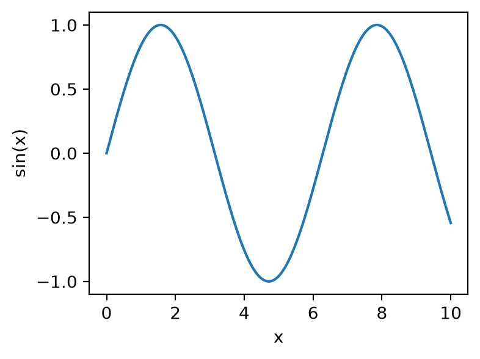
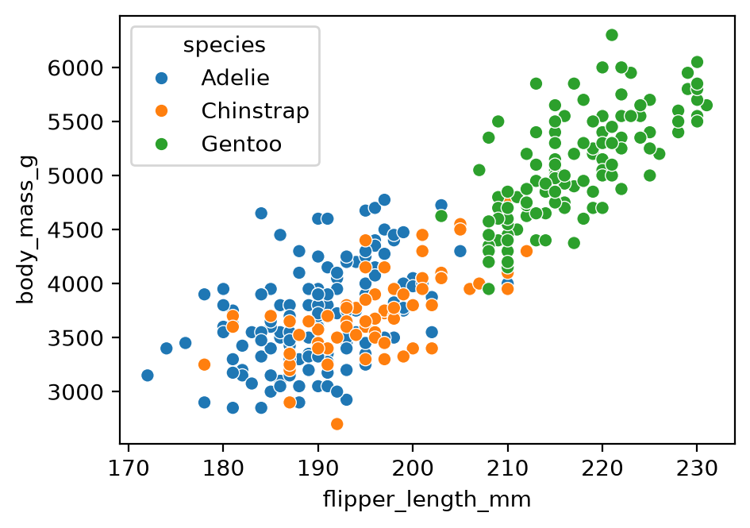
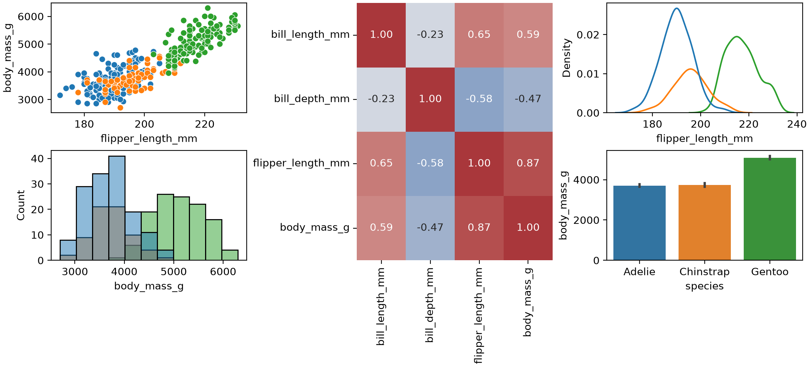
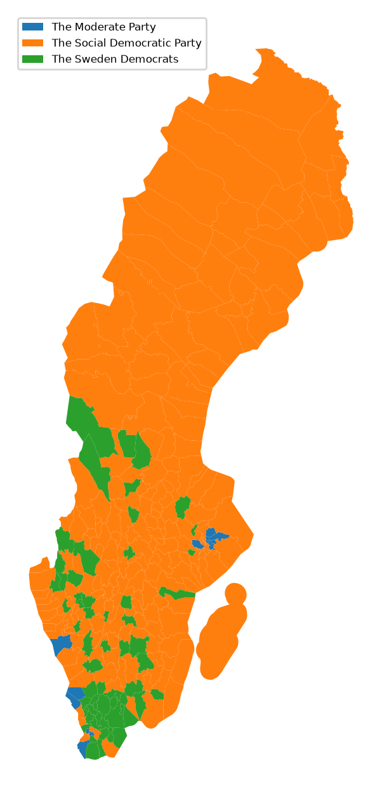

## Introduction

A figure communicates a message, not just the data. A good figure is accurate first (never mislead or distort), then clear and pleasing to look at.

This walkthrough covers the Python plotting stack for publication and poster figures:

- **Matplotlib** is the base layer. Seaborn and pandas draw through it.
- **Seaborn** and **pandas** wrap Matplotlib with shorter syntax for common plots.
- **Bokeh** and **Plotly** are separate libraries for interactive plots.

Install the libraries with `pixi add numpy matplotlib seaborn pandas`, or your package manager of choice.

The advice on figure design comes from Claus O. Wilke's free online book, [*Fundamentals of Data Visualization*](https://clauswilke.com/dataviz/). The book organises chapters by what you want to convey (amounts, distributions, proportions, associations, time series) rather than by data type.

## Matplotlib: figure, axes and artists

Matplotlib has two interfaces. The implicit one, common in online examples, draws on a hidden "current" figure:

```python
import matplotlib.pyplot as plt
import numpy as np

x = np.linspace(0, 10, 200)
plt.plot(x, np.sin(x))
```

Use the explicit interface instead. It gives you named objects to change later. Matplotlib has three terms for them:

- **Figure** (`fig`): the whole page. You save or print this.
- **Axes** (`ax`): one chart area, with its own x and y limits, ticks and labels. A figure holds one or more.
- **Artists**: everything visible: lines, dots, text, the box around the plot, tick marks.

```python
fig, ax = plt.subplots()          # a figure with one axes
ax.plot(x, np.sin(x))             # a line plot of a sine wave, drawn on that axes
fig.savefig("sine.png", dpi=200, bbox_inches="tight")
```

In a script, add `plt.show()` to open a window. Jupyter shows figures automatically.

{width=300}

`plt.subplots()` with no arguments creates a 1×1 grid. `plt.subplots(2, 5)` creates two rows of five axes and returns them as an array (`axs[0, 1]` is row 0, column 1).

Everything you see is an artist you can restyle after plotting. Change tick labels and fonts on the axes:

```python
ax.set_xticks([0, np.pi, 2 * np.pi, 3 * np.pi])
ax.set_xticklabels(["0", "π", "2π", "3π"], fontsize=14, rotation=30, color="navy")
ax.set_yticks([-1, 0, 1], labels=["min", "0", "max"], fontsize=12)
ax.tick_params(axis="y", length=8, width=2)   # the tick marks themselves
ax.minorticks_on()
```

To layer a second plot, a trend line or text on a plot, call another method on the same axes:

```python
categories, values, trend = ["a", "b", "c"], [1, 2, 3], [1.2, 1.9, 3.1]
fig, ax = plt.subplots()
ax.bar(categories, values, alpha=0.5)   # alpha = transparency, so layers show through
ax.plot(categories, trend)              # trend line over the bars
ax.text("c", 3.2, "outlier", fontsize=10)
```

## Seaborn: the same figure in fewer lines

Seaborn draws on Matplotlib axes and assumes sensible defaults for data frames (pandas tables). Compare a scatter plot of penguin flipper length against body mass, coloured by species:

```python
import seaborn as sns

penguins = sns.load_dataset("penguins")   # downloads the example data set on first use
```

::: {.panel-tabset}

## Seaborn

```python
fig, ax = plt.subplots()
sns.scatterplot(data=penguins, x="flipper_length_mm", y="body_mass_g",
                hue="species", ax=ax)
```

## Matplotlib only

```python
fig, ax = plt.subplots()
for species, group in penguins.groupby("species"):
    ax.scatter(group["flipper_length_mm"], group["body_mass_g"], label=species)
ax.set_xlabel("Flipper length (mm)")
ax.set_ylabel("Body mass (g)")
ax.legend()
```

:::

{width=400}

Seaborn also provides plots that are laborious in Matplotlib alone, such as `sns.clustermap` (a heat map with clustering trees, called dendrograms, on the rows and columns).

## pandas: quick plots from a data frame

A data frame has a `.plot` accessor that wraps Matplotlib. Use it to browse chart types quickly:

```python
df = penguins.select_dtypes("number")       # the numeric columns of the penguin table
df.plot()                                   # one line per column, with a legend
df.plot.box()                               # one box plot per column
df.plot.hexbin(x="flipper_length_mm", y="body_mass_g", gridsize=25)   # colour = points per hexagon
```

The [pandas visualisation guide](https://pandas.pydata.org/docs/user_guide/visualization.html) lists every plot kind.

## Composite figures with GridSpec

Publication figures often mix plot types in an uneven layout. `GridSpec` divides the figure into a grid, and each axes can span several cells. Create the axes first, then pass each one to a Seaborn or Matplotlib function (this reuses `plt`, `sns` and `penguins` from the Seaborn section):

```python
fig = plt.figure(figsize=(11, 5), layout="constrained")
gs = fig.add_gridspec(2, 3)

ax_scatter = fig.add_subplot(gs[0, 0])
ax_hist    = fig.add_subplot(gs[1, 0])
ax_heat    = fig.add_subplot(gs[:, 1])   # all rows, column 1: spans both rows
ax_density = fig.add_subplot(gs[0, 2])
ax_bars    = fig.add_subplot(gs[1, 2])

sns.scatterplot(data=penguins, x="flipper_length_mm", y="body_mass_g",
                hue="species", ax=ax_scatter, legend=False)
sns.histplot(data=penguins, x="body_mass_g", hue="species",
             ax=ax_hist, legend=False)
sns.heatmap(penguins.select_dtypes("number").corr(), annot=True, fmt=".2f",
            cmap="vlag", center=0, ax=ax_heat, cbar=False)
sns.kdeplot(data=penguins, x="flipper_length_mm", hue="species",
            ax=ax_density, legend=False)
sns.barplot(data=penguins, x="species", y="body_mass_g",
            hue="species", legend=False, ax=ax_bars)

fig.savefig("figure.svg")
```



SVG and PDF are vector formats (shapes, not pixels), so you can edit the figure by hand in Inkscape or Illustrator.

## Maps with geopandas

`geopandas` extends pandas with geographic data types. In the demo, I plotted which party won each Swedish municipality in an election. Once the data frame has one row per municipality with its boundary shape (the `geometry` column) and a result, the plotting itself is a single `.plot(column=..., legend=True)` call.

This version uses two open data sets: municipality boundaries from [Opendatasoft](https://public.opendatasoft.com/explore/dataset/georef-sweden-kommun/information/), and 2022 Riksdag election results from [Statistics Sweden's open API](https://www.scb.se/en/services/open-data-api/). It needs `pixi add geopandas requests` and an internet connection.

```python
import io
import geopandas as gpd
import matplotlib.pyplot as plt
import pandas as pd
import requests

# Boundaries: 290 simplified municipality polygons
geo = gpd.read_file(
    "https://public.opendatasoft.com/api/explore/v2.1/catalog/datasets/georef-sweden-kommun/exports/geojson"
)
geo["id"] = geo["kom_code"].str[0]    # codes arrive as one-item lists, e.g. ["0126"]

# Vote share per party and municipality, 2022, as CSV
url = ("https://api.scb.se/OV0104/v1/doris/en/ssd/START/ME/ME0104/ME0104C/ME0104T3")
query = {
    "query": [
        {"code": "Region", "selection": {"filter": "item", "values": list(geo["id"])}},
        {"code": "Partimm", "selection": {"filter": "item",
         "values": ["M", "C", "FP", "KD", "MP", "S", "V", "SD"]}},
        {"code": "ContentsCode", "selection": {"filter": "item", "values": ["ME0104B7"]}},
        {"code": "Tid", "selection": {"filter": "item", "values": ["2022"]}},
    ],
    "response": {"format": "csv"},
}
resp = requests.post(url, json=query, timeout=60)
resp.raise_for_status()
votes = pd.read_csv(io.StringIO(resp.text))
votes.columns = ["region", "party", "share"]
votes["id"] = votes["region"].str[:4]    # "0114 Upplands Väsby" -> "0114"

# The party with the highest vote share in each municipality
winner = votes.loc[votes.groupby("id")["share"].idxmax(), ["id", "party"]]

fig, ax = plt.subplots(figsize=(4, 8))
geo.merge(winner, on="id").plot(column="party", legend=True, ax=ax,
                                legend_kwds={"loc": "upper left", "fontsize": 6})
ax.set_axis_off()
```

{width=300}

## Interactive and other libraries

- [**Bokeh**](https://bokeh.org/) combines Python and JavaScript for interactive plots in a browser. It suits local exploration.
- [**Plotly**](https://plotly.com/python/) does not build on Matplotlib but covers similar ground, with an optional commercial platform for apps.
- [**plotnine**](https://plotnine.org/) brings the grammar of graphics, with R's ggplot2 syntax, to Python.
- [**Altair**](https://altair-viz.github.io/) describes a plot declaratively: you state what to plot, not how to draw it.

Choose by output: paper, poster or interactive.

## Tips from *Fundamentals of Data Visualization*

Each tip links to the relevant chapter of the [book](https://clauswilke.com/dataviz/).

**Check the size at the final scale.** Plotting software sets axis labels and tick labels too small by default. Create the figure at that size (`plt.subplots(figsize=(4, 3))`, in inches) or view it from a distance to check it is still legible ([Use larger axis labels](https://clauswilke.com/dataviz/small-axis-labels.html)). Set the default font size for every later figure once:

```python
plt.rcParams["font.size"] = 12
```

**Use colour with a purpose.** Qualitative colour works best for three to five categories. Beyond about eight, label items directly. Avoid rainbow scales for continuous data. About 8% of men and 0.5% of women have a colour-vision deficiency, and red–green contrasts are the most affected. The book recommends the Okabe–Ito palette for categories ([Common pitfalls of color use](https://clauswilke.com/dataviz/color-pitfalls.html)):

```python
okabe_ito = ["#E69F00", "#56B4E9", "#009E73", "#F0E442",
             "#0072B2", "#D55E00", "#CC79A7", "#000000"]
sns.set_palette(okabe_ito)
```

**Don't go 3D.** The third dimension carries no data, and projecting it onto a flat page distorts values: front slices look larger, bars look shorter. Encode extra variables with colour, size or shape, or use small multiples ([Don't go 3D](https://clauswilke.com/dataviz/no-3d.html)).

**Write titles as claims and label units.** A title states the finding ("Gentoo penguins are heavier"), not "This figure shows…". Axis titles name the variable and its unit ([Titles, captions, and tables](https://clauswilke.com/dataviz/figure-titles-captions.html)).

**Prefer solid shapes to outlines.** Filled bars, shaded density curves and solid points read more clearly than outlines and open symbols ([Avoid line drawings](https://clauswilke.com/dataviz/avoid-line-drawings.html)).

**Balance density.** Do not fill every gap, and do not leave large empty areas ([Balance the data and the context](https://clauswilke.com/dataviz/balance-data-context.html)).

## Key takeaways

- A figure is the whole page. An axes is one chart area. Change tick labels and fonts on the axes.
- Use `fig, ax = plt.subplots()` rather than `plt.plot()`. It gives you named objects to restyle later.
- Seaborn and pandas draw on Matplotlib axes, so you can mix them in one figure and restyle the result with Matplotlib.
- Check a figure at its final printed size, about three to five inches wide.
- Avoid 3D, avoid rainbow scales, and choose colours that work for colour-blind readers.

## Data sources and licences

- **Palmer penguins** (`sns.load_dataset("penguins")`): Gorman KB, Williams TD, Fraser WR (2014), collected at Palmer Station, Antarctica LTER, a member of the US Long Term Ecological Research Network. Released under [CC0](https://creativecommons.org/share-your-work/public-domain/cc0/) via the [palmerpenguins](https://allisonhorst.github.io/palmerpenguins/) package. Cite the package as: Horst AM, Hill AP, Gorman KB (2020). *palmerpenguins: Palmer Archipelago (Antarctica) penguin data*. [doi:10.5281/zenodo.3960218](https://doi.org/10.5281/zenodo.3960218). To publish the data itself, the palmerpenguins authors ask you to contact Dr Kristen Gorman. Seaborn downloads a copy from its [seaborn-data](https://github.com/mwaskom/seaborn-data) repository.
- **Election results**: data from Statistics Sweden, table [ME0104T3](https://www.statistikdatabasen.scb.se/pxweb/en/ssd/START__ME__ME0104__ME0104C/ME0104T3/), accessed through the [open data API](https://www.scb.se/en/services/open-data-api/). Released under CC0, so attribution is optional. The map above is derived from the table.
- **Municipality boundaries**: Opendatasoft's [Kommuner - Sweden](https://public.opendatasoft.com/explore/dataset/georef-sweden-kommun/information/) data set, derived from GSD-Sverigekartor by [Lantmäteriet](https://www.lantmateriet.se/) (the Swedish mapping authority), with simplified geometries. The data set page states no licence. Lantmäteriet publishes its [open geodata](https://www.lantmateriet.se/oppnadata) under CC0, but its page does not name this product, so check the terms before redistributing the file or publishing a figure made from it. The example downloads the file at run time rather than copying it.

## Resources

- [Fundamentals of Data Visualization](https://clauswilke.com/dataviz/), Claus O. Wilke (free online)
- [Matplotlib documentation](https://matplotlib.org/stable/)
- [Seaborn documentation](https://seaborn.pydata.org/)
- [pandas visualisation guide](https://pandas.pydata.org/docs/user_guide/visualization.html)
- [geopandas](https://geopandas.org/)
- [plotnine](https://plotnine.org/)
